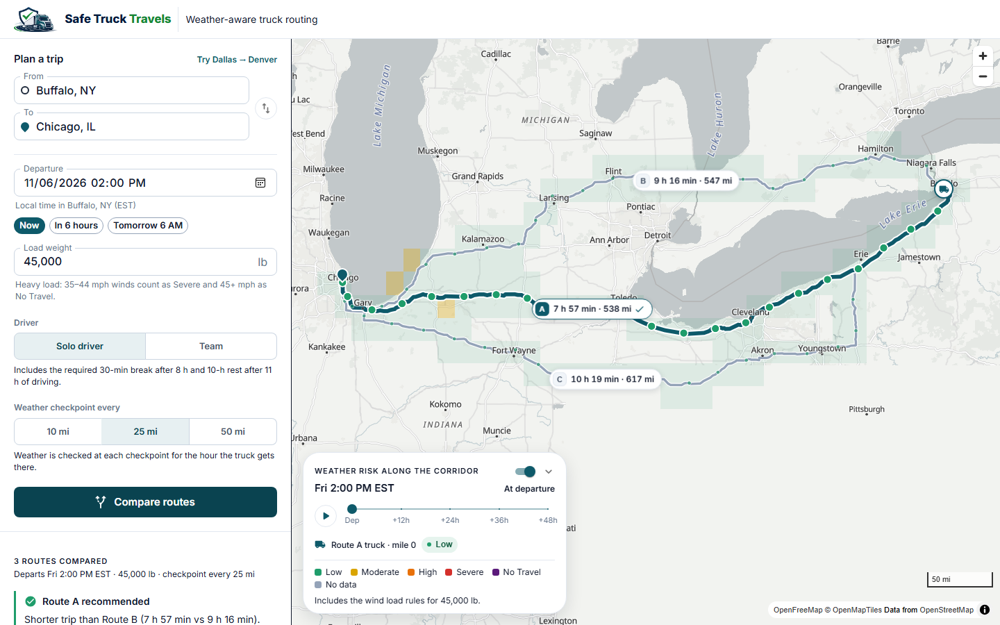
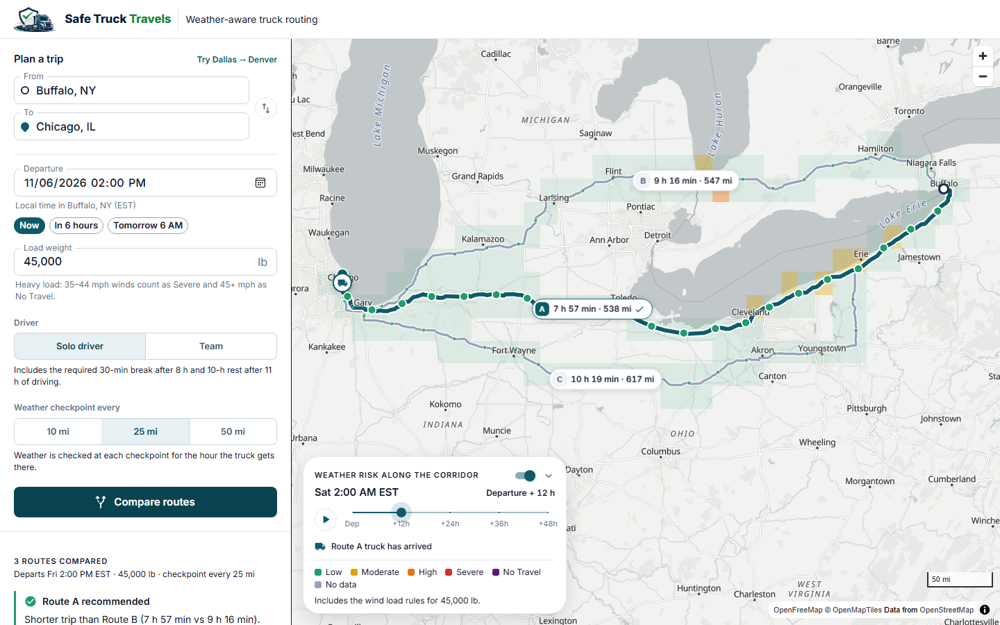
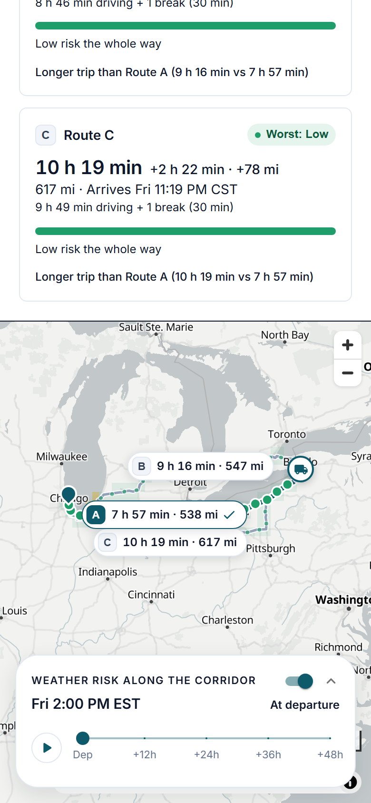

<p align="center">
  
</p>

# Safe Truck Travels: weather-aware truck routing

Enter an origin, a destination, a departure time and a load weight. The app finds up to three
truck routes, reads the forecast at each checkpoint **for the hour the truck actually gets there**,
scores the risk with the brief's rules, and recommends the safest route. A corridor heatmap with a
0–48 hour slider shows how the weather moves along the trip.

- **Live app:** https://safe-truck-travel.onrender.com
- **Source:** https://github.com/shayankashif123/Safe-Truck-Travel
- **Walkthrough (Loom):** _link added on submission_

> The app runs on Render's free plan. If nobody has opened it for a while it can take about a
> minute to wake up; the first trip after that takes roughly 10 seconds (a repeat takes about 1).





<p align="center">
  
</p>

## The brief, point by point

| The brief asks for | Where it is |
| --- | --- |
| Origin, destination, departure, load weight | Trip form; the departure is typed in the **origin's** local time |
| 3 route options from a routing API | TomTom truck routing, 1 route plus 2 alternatives ([tomtom.py](backend/trips/providers/tomtom.py)) |
| Weather every 10 / 25 / 50 miles at the truck's ETA | Spacing selector; each checkpoint reads the forecast for its own arrival hour ([checkpoints.py](backend/trips/domain/checkpoints.py), [trip_planner.py](backend/trips/services/trip_planner.py)) |
| Risk from the provided risk and load rules | [rules.py](backend/trips/domain/rules.py) holds the tables as data; [classification.py](backend/trips/domain/classification.py) applies them |
| Recommend the best route | [ranking.py](backend/trips/domain/ranking.py), with a plain-language reason in the UI |
| All routes, checkpoints, risk, ETAs and summaries on a map | MapLibre map; every route and checkpoint is drawn, with ETAs in popups and a summary card per route |
| Heatmap along the corridor, 0–48 h slider | 49 hourly frames; scrubbing makes no network requests |

## How risk is scored

Every checkpoint gets the **worst** of three levels: wind (adjusted for the load), rain and snow.
The thresholds are the brief's, copied exactly. A band's lower bound is inclusive unless the brief
writes `>`.

| Level | Wind (mph) | Rain (in/hr) | Snow (in/hr) |
| --- | --- | --- | --- |
| Low | < 25 | < 0.10 | < 0.5 |
| Moderate | ≥ 25 | ≥ 0.10 | ≥ 0.5 |
| High | ≥ 35 | ≥ 0.25 | ≥ 1.0 |
| Severe | ≥ 45 | ≥ 0.50 | ≥ 2.0 |
| No Travel | ≥ 55 | > 1.00 | > 3.0 |

**Load rules** (they only ever raise the wind level, and never chain):

- 45–54 mph with a load **over** 30,000 lb → No Travel
- 35–44 mph with a load **over** 40,000 lb → Severe

So 40 mph with 50,000 lb is Severe, and exactly 30,000 lb does not trigger the first rule.
Wind is the sustained 10 m speed; gusts are shown but not scored (decision R2).

## How the arrival time is worked out

The ETA at a checkpoint comes from TomTom's own distance-and-time profile for the route, not from an
average speed, so slow city stretches and fast highways are both reflected. On top of that:

- **Required driver stops.** A solo driver takes a 30-minute break after 8 hours of driving and a
  10-hour rest after 11, following the FMCSA property-carrier rules. A **Team** setting keeps the
  truck moving. This changes *when* each checkpoint is reached, and therefore its weather. Stops are
  drawn on the map and on the heatmap timeline.
- **Time zones.** Everything is computed in UTC. Each time is shown in the local time of the place it
  belongs to, with the zone named (for example "Sat 2:40 PM MST").
- **Between forecast hours.** Wind uses the nearest hour (an instantaneous reading); rain and snow
  use the hour containing the ETA (an hourly total).

## How routes are ranked

Strictly, in this order. A later rule only matters when every earlier one is equal:

1. Fewest **No Travel** miles
2. Fewest miles **without a forecast**
3. Fewest **Severe** miles
4. Fewest **High** miles
5. Lowest **average risk** (Low 0 … No Travel 4, weighted by distance)
6. Shortest **travel time**, door to door including required stops

Rules 3–6 are the brief's list. Rules 1 and 2 are the two additions: a route you cannot legally
drive should never win, and missing data must never make a route look safer. When every route has a
full forecast and none has No Travel miles, which is the usual case, the order is exactly the brief's.

Each stretch between two checkpoints counts toward the **worse** of its two ends, so every mile is
counted exactly once and errs on the safe side. The UI explains the winner in words, shows the miles
at each level per route, and states the time cost of choosing the safer route.

## The heatmap

The corridor is a grid of quarter-degree cells (about 17 × 14 miles) within 12 miles of any route.
Each cell is classified with the same rules and load adjustment as the checkpoints, for each of the
49 hours after departure. The cell geometry is sent to the GPU once; moving the slider only rewrites
cell colours, with no request and no map re-render (about 13 ms of JavaScript per step, measured on
the production build). A truck marker follows the selected route to show where the truck will be, and
what the weather there will be, at the slider's hour.

## Architecture

```
React + TypeScript + MUI + MapLibre GL  ──HTTPS/JSON──▶  Django REST API
        (frontend/)                                        (backend/trips/)
                                                  api ─▶ services ─▶ providers ─▶ TomTom, Open-Meteo
                                                              │
                                                              ▼
                                                  domain  (pure Python: rules, ranking,
                                                           checkpoints, hours of service)
```

- **`domain/`** holds every rule: thresholds, classification, ranking, checkpoint placement, hours of
  service, the heatmap fast path. It imports no Django, HTTP or provider code, so it is tested with
  plain inputs and property tests.
- **`providers/`** are thin clients for TomTom and Open-Meteo. They turn each response into domain
  types and raise typed errors. Provider URLs and keys never reach logs or error messages.
- **`services/`** orchestrate a trip (routing, weather, caching, time zones).
- **`api/`** validates input and shapes the response; the API is stateless.
- **Frontend** is organised by feature (`trip-form`, `trip-results`, `map`). The backend decides the
  recommendation and the explanation data; the frontend only words it.

The full list of choices the brief left open, each with its reason, is in
**[docs/DECISIONS.md](docs/DECISIONS.md)**. The HTTP contract is in **[docs/API.md](docs/API.md)**.

### Decisions worth knowing

- **Weather quota.** Open-Meteo's free tier counts one call per *location*. Weather is fetched on
  fixed grids (1/16° for checkpoints, 1/4° for the heatmap), capped at 450 locations per trip, and
  cached for 30 minutes, so changing the load, the spacing or the departure never spends quota again.
- **Missing data is never "Low".** A checkpoint with no forecast is shown as *No data*, ranked
  after No Travel, and the recommendation says how many miles of the chosen route are unknown.
- **The strict priority list beats "balance".** The brief's ranking list is applied as written;
  the interface makes the trade-off visible instead of blending the criteria.
- **Fewer than three routes** are shown as returned, with a note. No route is ever invented.
- **Near-equal values** are compared at the precision the UI shows (0.1 mi, whole minutes), so
  floating-point noise cannot decide a recommendation.

## Run it locally

Requirements: Python 3.12+, Node 22+, and a free [TomTom developer key](https://developer.tomtom.com)
with the Routing, Geocoding and Places Search APIs enabled. Open-Meteo needs no key.

**Backend**

```bash
cd backend
python -m venv .venv
.venv\Scripts\activate              # macOS/Linux: source .venv/bin/activate
pip install -r requirements-dev.txt
copy .env.example .env              # macOS/Linux: cp .env.example .env
```

Edit `backend/.env`: set `TOMTOM_API_KEY`, and set `DJANGO_SECRET_KEY` to the output of
`python -c "import secrets; print(secrets.token_urlsafe(50))"`. Then:

```bash
python manage.py runserver          # http://127.0.0.1:8000
```

**Frontend**

```bash
cd frontend
npm install
npm run dev                          # http://localhost:5173, proxies /api to :8000
```

`.env` is git-ignored. **Never commit an API key.**

**Docker** (the same image that is deployed):

```bash
docker build -t safe-truck-travels .
docker run --rm -p 10000:10000 -e DJANGO_SECRET_KEY=change-me -e TOMTOM_API_KEY=your-key safe-truck-travels
# http://localhost:10000
```

## Tests and checks

```bash
# backend/
pytest                    # 327 tests, offline (provider responses come from fixtures)
pytest -m live            # contract checks against the real TomTom and Open-Meteo APIs
ruff check . && ruff format --check .

# frontend/
npm test                  # 79 tests: form rules, explanations, formatting, map and heatmap data
npm run lint && npm run typecheck && npm run format:check && npm run build
```

The rules most likely to hide a bug have the strongest tests: every threshold edge (24.9 / 25, rain
0.25 and exactly 1.00, 30,000 and 40,000 lb), load rules that must not chain, ranking ties and
precision, hours-of-service schedules, and a property test that proves the heatmap fast path equals
the checkpoint calculation for 40 random seeds. GitHub Actions runs lint, formatting, tests and the
Docker build on every push.

## Deployment (Render, free plan)

One Docker image serves both the API and the built React app, so there is one origin and no CORS.
[render.yaml](render.yaml) describes it as a Blueprint; creating a plain Web Service from the
`Dockerfile` works the same way if you set the variables below.

| Setting | Value |
| --- | --- |
| Environment | Docker, Free plan |
| Health check path | `/api/health/` |
| `DJANGO_SECRET_KEY` | any long random string (the Blueprint generates one) |
| `TOMTOM_API_KEY` | your TomTom key (set in Render only, never in the repo) |

Render sets `RENDER=true` and `RENDER_EXTERNAL_HOSTNAME` itself. The first enables per-client rate
limiting by Cloudflare's `CF-Connecting-IP`, the one client address a caller cannot forge behind
Render's proxies (decision D5). Debug is off, HSTS is on, the container runs as a non-root user, and
`.dockerignore` keeps every `.env` out of the image. On a 0.1-CPU instance a new trip takes about
10 seconds and a repeat about 1; the measurements are in decisions D2 and D3.

A scheduled GitHub Actions workflow pings the health endpoint every 10 minutes so the free instance
is awake when someone opens it.

## Known limitations

- **Free-tier weather.** Open-Meteo's free tier is for non-commercial use and limited to 600
  locations a minute. A trip uses up to 450, so several trips planned within the same minute can be
  answered with a "try again shortly" (503). Repeats and tweaks of the same trip use the cache.
- **Forecast window.** Departures are limited to the next 7 days. A checkpoint beyond the available
  forecast is shown as *No data*, never as Low.
- **Hours-of-service assumptions.** The driver starts rested, with full weekly hours. The 30-minute
  break and the 11-hour driving limit are modelled; the 14-hour window never binds with these stops
  (checked by a test), and the 60/70-hour weekly limit is not modelled (decision T3). Load weight is
  used for risk only and is not sent to the routing provider (decision K7).
- **Average risk favours longer routes with equal risky miles**, because extra Low miles lower the
  mean. The brief's rule is kept as written; the UI shows the extra distance and time next to each
  route (decision K3a).
- **Free hosting.** The service sleeps after 15 minutes without traffic; the keep-alive ping
  reduces but cannot remove that.
- **Region.** Place search is limited to the US and Canada, where the forecast models and the FMCSA
  rules apply.

## Data sources

- Routing and place search: [TomTom](https://developer.tomtom.com/) (API key required).
- Weather forecasts: [Open-Meteo](https://open-meteo.com/) (free tier, non-commercial use).
- Basemap: [OpenFreeMap](https://openfreemap.org/), © [OpenMapTiles](https://openmaptiles.org/), data
  © [OpenStreetMap](https://www.openstreetmap.org/copyright) contributors.
- Time zones: [timezonefinder](https://github.com/jannikmi/timezonefinder) with
  [timezone-boundary-builder](https://github.com/evansiroky/timezone-boundary-builder) data (ODbL), offline.
- Hours-of-service limits: [FMCSA summary](https://www.fmcsa.dot.gov/regulations/hours-service/summary-hours-service-regulations).
